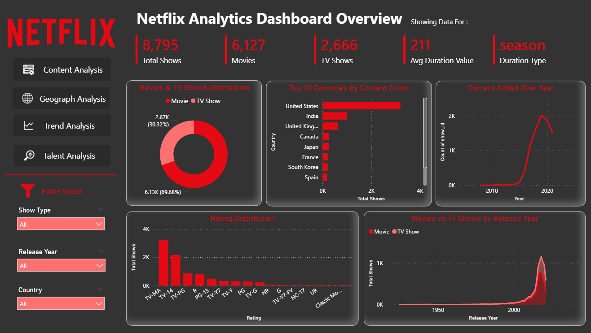
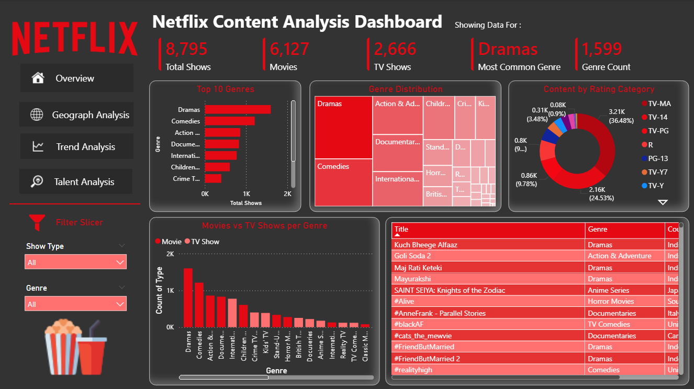
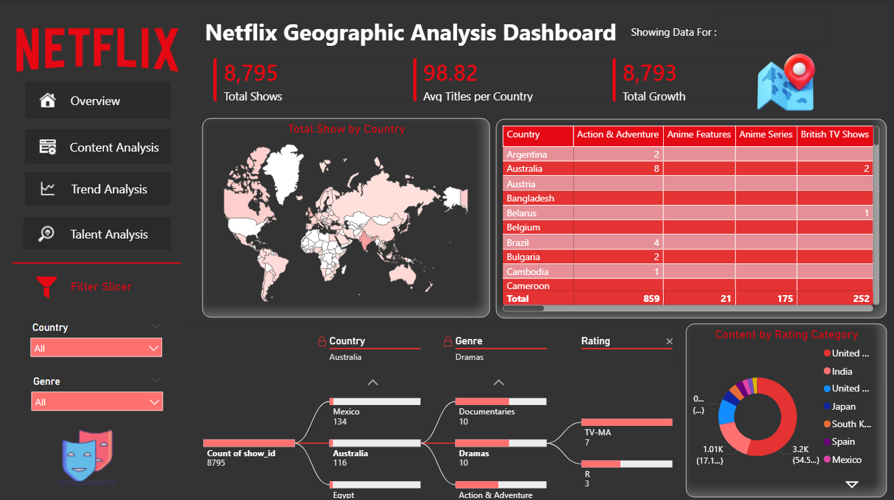
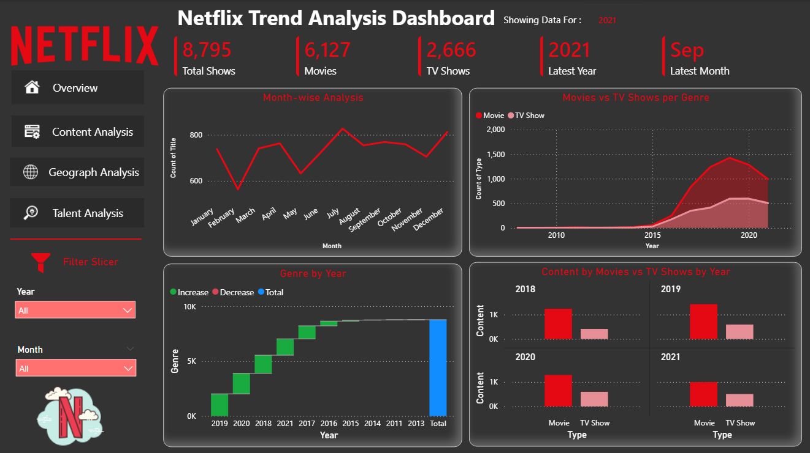
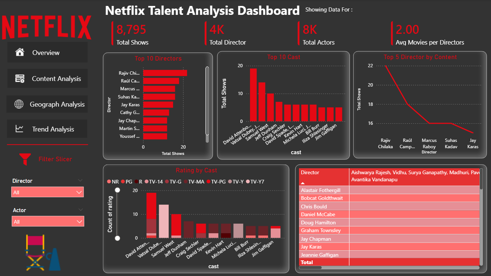

# Netflix Movies & TV Shows Analysis

## Project Overview

This project analyzes Netflix Movies and TV Shows using SQL and Power BI.

The objective is to extract business insights related to:

- Content distribution

- Country-wise analysis

- Ratings analysis

- Release trends

- Movies vs TV Shows comparison

- Genre analysis

- Director and Actor insights

## Tools Used

- Jupyter Notebook

- SQL

- PostgreSQL

- Power BI

- Excel

## Dataset

Netflix Movies and TV Shows Dataset

## Project Structure

- Dataset

- SQL Queries

- Power BI Dashboard

- Dashboard Images

- Project Report

## Key Insights

- Most common content type

- Top producing countries

- Most frequent actors/directors

- Yearly content growth

- Genre distribution

- Rating analysis

## Dashboard Preview

### Dashboard 1

### Dashboard 2

### Dashboard 3

### Dashboard 4

### Dashboard 5

## Author

Prerana D. Halge
